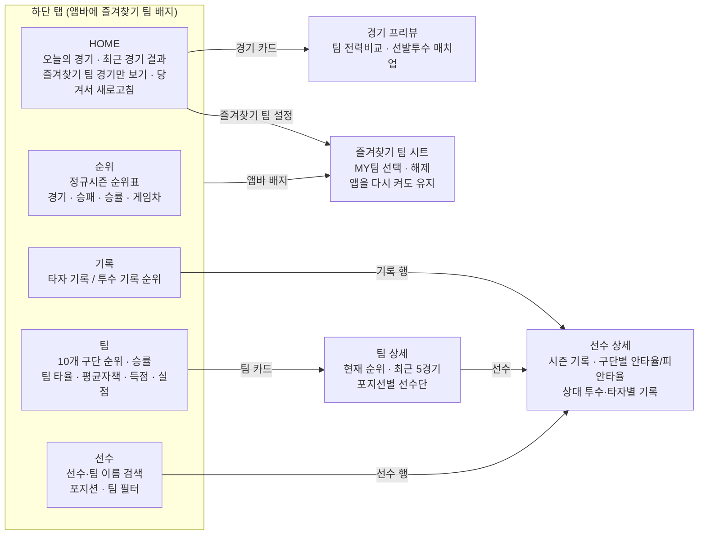
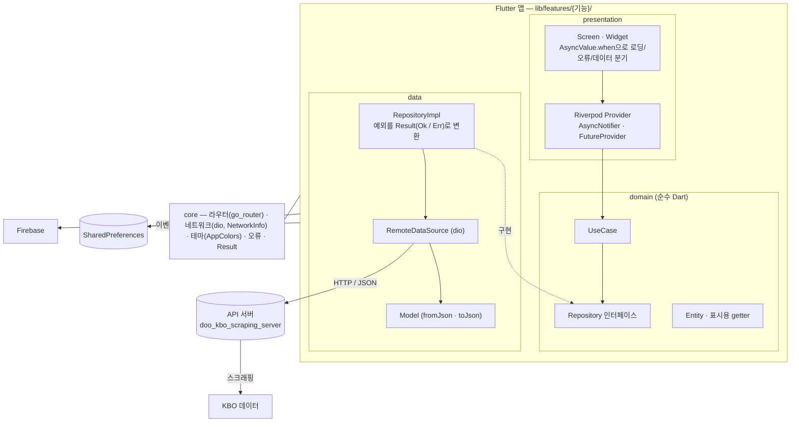
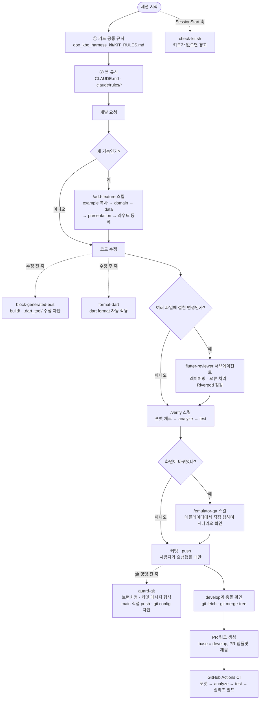

# 직관 (JIKGWAN)

> KBO 리그의 오늘 경기, 최근 결과, 순위, 기록, 팀·선수 정보를 한 앱에서 보는 Flutter 앱

## 화면 구성

하단 탭 5개와 상세 화면 3개로 이루어져 있습니다. 화살표는 화면 사이의 이동입니다.



화면별 상세 동작과 확인 방법은 [docs/TEST_SCENARIOS.md](docs/TEST_SCENARIOS.md)에 있습니다.

## 사용 기술

| 영역 | 기술 |
|---|---|
| 앱 | Flutter 3.44, Dart 3.12 |
| 상태 관리 · DI | flutter_riverpod 3.3 (`Provider`, `Notifier`, `AsyncNotifier`) |
| 라우팅 | go_router 17 (`StatefulShellRoute`로 하단 탭마다 이동 기록 유지) |
| 네트워크 | dio 5, connectivity_plus 7 |
| 로컬 저장 | shared_preferences 2 (즐겨찾기 팀) |
| UI | Material 3 다크 테마, flutter_svg 2 (구단 로고), 색은 `AppColors` 토큰으로만 사용 ([docs/DESIGN_TOKENS.md](docs/DESIGN_TOKENS.md)) |
| 모니터링 | Firebase Analytics, Firebase Crashlytics |
| 코드 품질 | flutter_lints + 엄격한 `analysis_options.yaml` (strict-casts, strict-inference 등), equatable, `flutter test` |
| CI/CD | GitHub Actions — PR마다 포맷 체크 → `flutter analyze` → `flutter test` → 릴리즈 빌드 검증, `main`에 머지되면 fastlane으로 Play Console 비공개 테스트 트랙에 업로드 |
| 백엔드 | 자체 API 서버 (`doo_kbo_scraping_server`, Nest.js) — KBO 데이터를 스크래핑해 JSON으로 제공 |
| AI 개발 환경 | Claude Code + 공용 하네스 [doo_kbo_harness_kit](https://github.com/shot013/doo_kbo_harness_kit) |

## 아키텍처

기능별 폴더 안에서 `presentation` → `domain` ← `data`로 계층을 나눈 Clean Architecture입니다.
`domain`은 Flutter와 다른 계층을 모르는 순수 Dart 코드이고, `data`가 `domain`의 인터페이스를 구현합니다.



```
lib/
  main.dart / app.dart   # Firebase 초기화, ProviderScope, MaterialApp.router
  core/                  # constants, error, network, providers, router, storage, theme, usecase, utils, widgets
  features/
    home/  main/         # HOME 화면, 하단 탭 셸
    game/                # 오늘 경기, 최근 결과, 경기 프리뷰
    standing/  record/   # 순위, 타자·투수 기록
    team/  player/       # 팀·선수 목록과 상세
    favorite_team/       # 즐겨찾기 팀 (SharedPreferences)
    example/             # 새 기능을 만들 때 복사하는 템플릿
```

자세한 데이터 흐름과 새 기능 추가 절차는 [docs/ARCHITECTURE.md](docs/ARCHITECTURE.md)에 있습니다.

### 왜 이 아키텍처인가

- **Feature-first + 계층 분리(domain/data/presentation)**: 여러 명이 동시에 다른 기능을 작업해도 폴더가 겹치지 않아 병합 충돌이 적고, 리뷰어가 `lib/features/{기능}/` 하나만 보면 그 기능의 전체 흐름을 파악할 수 있습니다.
- **domain 레이어의 순수성(Flutter SDK/`data`/`presentation` 비의존)**: UI나 네트워크 구현을 건드리지 않고도 비즈니스 로직(usecase)만 단위 테스트할 수 있고, 백엔드가 아직 없을 때는 `data`만 더미로 갈아끼우면 되므로(`example`의 `TeamDummyDataSource`처럼) 프론트엔드 개발이 API 완성을 기다릴 필요가 없습니다.
- **Riverpod**: 상태 관리와 의존성 주입을 하나의 도구로 처리해 provider 그래프만 보면 어떤 계층이 무엇에 의존하는지 추적할 수 있고, `AsyncNotifier` + `AsyncValue.when`으로 로딩/에러/성공 처리를 모든 화면에서 같은 패턴으로 강제합니다.
- **`Result<T>`(`Ok`/`Err`) 패턴**: 예외를 domain/presentation까지 그대로 전파시키지 않고 `data/repositories`에서 한 번에 `AppFailure`로 변환하도록 강제해, 에러 처리 누락으로 인한 크래시를 구조적으로 줄입니다.
- **엄격한 lint 규칙(`analysis_options.yaml`)**: 따옴표, trailing comma, import 경로처럼 사람마다 갈리기 쉬운 스타일을 기계적으로 통일해, 코드 리뷰가 스타일 논쟁이 아니라 로직 검토에 집중되도록 합니다.

## Claude Code로 개발하는 방식

이 저장소의 코드는 Claude Code가 규칙·스킬·훅을 따라 작성합니다. 여러 프로젝트가 공유하는 공통 규칙은
[doo_kbo_harness_kit](https://github.com/shot013/doo_kbo_harness_kit)에 두고, 이 앱은 그 위에 앱 고유 규칙만 얹습니다.



규칙을 어디에 두는지는 비용을 기준으로 정합니다. 매 턴 컨텍스트에 들어가는 규칙은 최소로 두고,
기계적으로 판정할 수 있는 것은 훅으로, 특정 작업에서만 필요한 절차는 스킬로 내립니다.

| 층 | 위치 | 언제 동작하나 | 이 저장소에서 하는 일 |
|---|---|---|---|
| 규칙 | 키트 `KIT_RULES.md` → `CLAUDE.md` → `.claude/rules/*` | 항상 (매 턴) | 레이어링, 오류 흐름, 색상, PR·충돌 확인 같은 판단 기준 |
| 훅 | `.claude/hooks/*` | 도구 호출 때 자동 | 키트 확인, 생성 파일 보호, 자동 포맷, git 규약 강제 |
| 스킬 | `.claude/skills/*` | 관련 작업일 때 | `/add-feature`, `/verify`, `/emulator-qa` |
| 서브에이전트 | `.claude/agents/flutter-reviewer.md` | 여러 파일 변경 후 | 린터가 못 잡는 아키텍처 리뷰 |

자세한 설명은 [docs/CLAUDE_CODE.md](docs/CLAUDE_CODE.md), 단계별 발동 순서는 [docs/RULE_APPLICATION_ORDER.md](docs/RULE_APPLICATION_ORDER.md)에 있습니다.

## 시작하기

```
flutter pub get
flutter run                                              # 기본 API 서버로 실행
flutter run --dart-define=BASE_URL=http://<PC-IP>:3651   # 로컬 API 서버로 실행
```

Claude Code로 작업한다면 저장소 루트에 하네스 키트도 받아둡니다 (`.gitignore` 대상).

```
git clone https://github.com/shot013/doo_kbo_harness_kit.git
```

## 문서

- [docs/ARCHITECTURE.md](docs/ARCHITECTURE.md) — 폴더 구조, 데이터 흐름, 새 기능 추가 절차
- [docs/TEST_SCENARIOS.md](docs/TEST_SCENARIOS.md) — 화면별 테스트 시나리오(에뮬레이터), 발견된 결함
- [docs/DESIGN_TOKENS.md](docs/DESIGN_TOKENS.md) — 색상 토큰
- [docs/CLAUDE_CODE.md](docs/CLAUDE_CODE.md) — Claude Code 규칙·스킬·훅 정리
- [CONTRIBUTING.md](CONTRIBUTING.md) — 브랜치 전략, 커밋 컨벤션, PR 규칙
