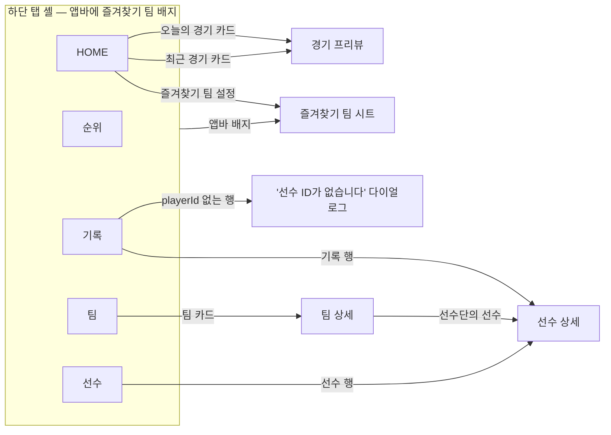

# 테스트 시나리오 (에뮬레이터)

실제 앱을 에뮬레이터에 띄우고, 사람이 쓰듯 탭하며 기능이 정상 동작하는지 확인하는 시나리오입니다.
Claude Code는 `/emulator-qa` 스킬로 이 문서를 순서대로 실행하고 시나리오별 결과표를 냅니다
(조작 도구: `.claude/skills/emulator-qa/emu.sh`). 사람이 직접 따라 해도 됩니다.

- 대상: 디버그 빌드, 실제 백엔드(`http://15.164.113.221:3651`), 에뮬레이터 `Pixel_10_Pro` (1280×2856).
- 확인 방법: 화면 텍스트(접근성 덤프), 앱이 보낸 API 요청(디버그 빌드의 dio 로그), 스크린샷(잘림·겹침·빈 화면).
- 서버 데이터는 날마다 바뀝니다(오늘 경기 유무, 시즌 기록 유무 등). "데이터 조건"이 있는 시나리오는 먼저 조건을 확인하고 그에 맞는 기대 결과로 판정합니다. 조건이 맞지 않으면 **보류**입니다.
- 기대 결과는 "앱이 이렇게 동작해야 한다"입니다. 알려진 결함 때문에 지금 실패하는 시나리오는 결함 ID를 함께 적었습니다.

## 이동 경로

- 하단 탭을 오가도 각 탭의 상태(선택한 토글, 필터)가 유지됩니다.
- 상세 화면(프리뷰, 팀 상세, 선수 상세)은 하단 탭과 앱바 배지 없이 전체 화면으로 열리고, 뒤로 가면 원래 탭으로 돌아옵니다.
- 경기 일정(`/games`)과 박스 스코어(`/games/:id`)는 라우터에는 있지만 앱 UI에서 들어가는 경로가 없고, 앱에 딥링크 설정도 없어 기기에서 열 방법이 없습니다(`BUG-05`).

## 시나리오

단계의 `tab 3`, `tapt "…"`, `requests` 같은 표기는 `emu.sh` 명령입니다.

### 내비게이션 `NAV`

| ID | 단계 | 기대 결과 |
|---|---|---|
| NAV-01 | 앱 재시작(`restart`) | HOME이 열리고 `오늘의 경기`가 보인다. 하단 탭 버튼 5개가 있고 활성 탭 라벨은 `HOME`이다. |
| NAV-02 | `tab 1` → `tab 2` → `tab 3` → `tab 4` → `tab 0` | 순서대로 순위(`정규시즌`), 기록(`타자 기록`), 팀(`1위(게임차`), 선수(포지션 칩 `내야수`), HOME(`오늘의 경기`)이 열리고 활성 라벨이 바뀐다. |
| NAV-03 | 기록 탭에서 `투수 기록` → 팀 탭 → 기록 탭 | `투수 기록`이 그대로 선택돼 있다(`평균자책` 헤더). |
| NAV-04 | 팀 탭 → 1위 팀 카드 → 뒤로 | 팀 상세(`선수단`)가 하단 탭 없이 열리고, 뒤로 가면 팀 목록과 하단 탭이 다시 보인다. |
| NAV-05 | HOME에서 `logclear` → `background` → 3초 → `launch` | 복귀하면 `/games?gameDate=<오늘>`, `/game-results/recent`를 다시 요청한다. |
| NAV-06 | `restart` | 강제 종료 후 다시 켜도 HOME으로 정상 시작한다. |

### HOME `HOME`

| ID | 단계 | 기대 결과 |
|---|---|---|
| HOME-01 | HOME 확인, `requests` | 날짜 라벨이 오늘(`MM.DD (요일)`)이고 `/games?gameDate=<오늘 YYYY-MM-DD>`로 요청한다. **데이터 조건** — 오늘 경기 있음: 카드마다 두 팀 표시명, 선발투수(있으면), 상태별 문구(예정 `HH:MM 구장 (경기 예정)`, 진행 중 `구장 (n회초/말)`+점수, 종료 `구장 (경기 종료)`+점수). 없음: 빈 카드(`예정된 경기가 없는 날이에요`). |
| HOME-02 | 최근 경기 결과 확인 | 제목이 `최근 경기 결과 YYYY-MM-DD`이고 카드에 `팀 \| 점수 : 점수 \| 팀`. 승·패·세·홀 투수와 `베스트 활약`은 데이터가 있을 때만 보인다. 결과가 없으면 `최근 종료된 경기가 없습니다`. |
| HOME-03 | 오늘의 경기 카드 탭 | `경기 프리뷰`가 열리고 `/game-previews/<gameId>`를 요청한다. **데이터 조건** — 프리뷰 있음(API 200): `팀 전력비교`, `선발투수 매치업`, 헤더에 두 팀 표시명과 `VS`. 없음(404): 3초 안에 `아직 이 경기의 프리뷰 정보가 없습니다.` (지금은 약 20초, `BUG-09`) |
| HOME-04 | 뒤로 → 최근 경기 카드 탭 | HOME-03과 같은 기준. |
| HOME-05 | `logclear` → `pull` | `/games`와 `/game-results/recent`를 다시 요청한다. (지금은 내용이 화면보다 짧으면 동작하지 않음, `BUG-10`) |
| HOME-06 | 오늘 경기가 없는 팀을 즐겨찾기 → 빈 카드의 `최근경기 요약 보러가기` 탭 | 최근 경기 결과로 이동한다. (지금은 반응 없음, `BUG-02`) |

### 즐겨찾기 팀 `FAV`

시작 전에 `badge`로 원래 즐겨찾기 팀을 기록하고, 끝나면 되돌립니다.

| ID | 단계 | 기대 결과 |
|---|---|---|
| FAV-01 | 즐겨찾기가 없는 상태에서 `즐겨찾기 팀 설정` → 오늘 경기가 있는 팀 선택(없으면 아무 팀) | 시트에 10개 팀이 보이고, 고르면 시트가 닫히며 앱바 배지가 그 팀 코드로 바뀌고 오늘의 경기에는 그 팀 경기만 남는다. |
| FAV-02 | 선수 탭에서 앱바 배지 → 다른 팀 → HOME | 어느 탭에서든 바꿀 수 있고, HOME 필터가 새 팀으로 바뀐다. |
| FAV-03 | `restart` | 배지와 필터가 유지된다. |
| FAV-04 | 배지 → `즐겨찾기 해제` | 배지가 사라지고 오늘 경기가 모두 보인다. |
| FAV-05 | MY팀을 KT로 → 팀 탭 → `kt wiz` 상세 | 버튼이 `즐겨찾기됨`이다. 다른 팀 상세에서 `즐겨찾기`를 누르면 앱바 배지가 그 팀으로 바뀐다. (지금은 MY팀과 따로 동작, `BUG-01`) |

### 순위 `STD`

| ID | 단계 | 기대 결과 |
|---|---|---|
| STD-01 | `tab 1` | `2026`, `정규시즌`, 헤더(순위·경기·승·패·무·승률·게임차), 10개 팀 행이 1~10위 순서로 위에서 아래로. 1위 팀이 `/standings` 응답과 같다. |

### 기록 `REC`

| ID | 단계 | 기대 결과 |
|---|---|---|
| REC-01 | `tab 2` | `타자 기록`이 선택돼 있고 헤더 타율·홈런·타점. **데이터 조건** — 기록 있음: 순위·선수·팀 로고·기록 행. 없음(`/records/batters`가 빈 배열): 빈 상태 안내 문구. (지금은 헤더만 보임, `BUG-11`) |
| REC-02 | `투수 기록` → `타자 기록` | 헤더가 평균자책·승패·세이브로 바뀌었다가 타율·홈런·타점으로 돌아온다. |
| REC-03 | 기록 행 탭 | 그 선수의 상세(`No.`)가 열린다. 기록이 없으면 보류. |
| REC-04 | `playerId`가 없는 기록 행 탭 | `선수 ID가 없습니다` 다이얼로그, `확인`으로 닫히고 이동하지 않는다. 그런 행이 없으면 보류. |

### 팀 `TEAM`

| ID | 단계 | 기대 결과 |
|---|---|---|
| TEAM-01 | `tab 3` | 10개 팀 카드, 각 카드에 `n위(게임차 x) · W승 L패 D무 · 승률 r`와 팀 타율·평균자책·득점·실점. |
| TEAM-02 | 1위 팀 카드 탭 | `/teams/<코드>`를 요청하고 제목 팀명, `현재 1위 · W승 L패`, `최근 5경기` 배지 5개, `선수단`과 포지션별 선수가 보인다. |
| TEAM-03 | 선수단 첫 선수 탭 → 뒤로 → 뒤로 | 선수 상세(`No.`)가 열리고, 뒤로 가면 팀 상세, 한 번 더 가면 팀 목록. |
| TEAM-04 | 팀 상세의 `즐겨찾기`를 두 번 탭 | `즐겨찾기됨` ↔ `즐겨찾기`로 바뀐다. |

### 선수 `PLY`

| ID | 단계 | 기대 결과 |
|---|---|---|
| PLY-01 | `tab 4`, `requests` | `/players?limit=500`을 요청하고 행마다 `이름 \| 팀명 · 포지션 \| 주요 기록`. |
| PLY-02 | `tapinput` → `logclear` → `typeko <목록 첫 선수 이름>` | 마지막 요청이 `search=<이름>`이고 결과 첫 행이 그 선수다. 입력을 멈춘 뒤 한 번만 요청한다. (지금은 글자마다 요청, `BUG-06`) |
| PLY-03 | `erase` → `typeko 없는선수` | `검색 결과가 없습니다.` 확인 후 `erase`, `back`(키보드 닫기). |
| PLY-04 | `투수` 칩 → 팀 칩 `LG` → `전체`(위) → `전체`(아래) | 요청이 `position=pitcher` → `teamCode=LG&position=pitcher`(행이 모두 `LG 트윈스 · 투수`) → `teamCode=LG` → 조건 없음 순으로 바뀐다. 팀 칩 라벨이 다른 화면과 같은 표기다. (`kt` 소문자, `BUG-07`) |
| PLY-05 | 타자(내야수·외야수) 행 탭 | `이름 \| 팀명 · 포지션 · No.N`, 시즌 기록, `구단별 안타율`, 데이터가 있으면 `상대 투수별 안타율`. |
| PLY-06 | `투수` 칩 → 첫 투수 탭 | `구단별 피안타율`, 데이터가 있으면 `상대 타자별 삼진율`. |

### 오류 `ERR`

| ID | 단계 | 기대 결과 |
|---|---|---|
| ERR-01 | `net off` → `restart` | 3초 안에 HOME 두 곳에 `네트워크 연결을 확인해주세요.` 다른 탭도 같은 문구. (지금은 약 44초, `BUG-09`) |
| ERR-02 | `net on` → `restart` | 데이터가 정상으로 다시 보인다. |

### 화면 점검

각 시나리오의 스크린샷에서 함께 봅니다.

- 팀 로고(SVG 8개, PNG 2개)가 깨지지 않는다.
- 목록 마지막 항목이 떠 있는 하단 탭에 가려지지 않는다.
- 즐겨찾기 팀 시트가 하단 탭 위에 그려진다.
- 글자가 잘리거나 카드 밖으로 넘치지 않는다.

## 발견된 결함

고치면 해당 줄을 지우고 관련 시나리오의 "지금은 …" 문구를 지웁니다.

| ID | 내용 | 확인 방법 | 시나리오 |
|---|---|---|---|
| BUG-01 | 팀 상세의 `즐겨찾기`는 메모리 전용 `favoriteTeamsProvider`를 써서 HOME의 MY팀(SharedPreferences)과 연결되지 않고, 재시작하면 사라진다. | MY팀이 KT인데 kt wiz 상세 버튼이 `즐겨찾기` | FAV-05 |
| BUG-02 | 오늘 경기가 없을 때 빈 카드의 `최근경기 요약 보러가기` 버튼이 아무 동작도 하지 않는다(`onPressed: () {}`). | 탭 후 화면·요청 변화 없음 | HOME-06 |
| BUG-03 | 빈 카드 문구가 항상 `오늘은 즐겨찾기 팀 경기가 없습니다`라, 즐겨찾기 팀이 없고 경기도 없는 날에도 즐겨찾기 문구가 나온다. | 코드 | HOME-01 |
| BUG-04 | 순위 탭의 `2026`·`정규시즌`은 드롭다운처럼 보이지만 선택할 수 없는 고정 텍스트다. | 코드 | STD-01 |
| BUG-05 | 경기 일정·박스 스코어 화면(`/games`, `/games/:id`)과 `/example`은 UI에서 들어가는 경로가 없고, 딥링크 설정도 없어 기기에서는 열 수 없다. | 코드 | — |
| BUG-06 | 선수 검색이 글자를 입력·삭제할 때마다 서버에 요청한다(디바운스 없음). | 3글자 입력에 요청 3건 | PLY-02 |
| BUG-07 | 선수 탭의 팀 필터 칩만 `kt` 소문자로 보인다(다른 화면은 `KT`). | 칩 라벨 | PLY-04 |
| BUG-08 | 백그라운드에 1초만 있었어도 복귀 시 목록을 다시 요청해 로딩 표시가 깜빡인다. | 복귀 시 요청 | NAV-05 |
| BUG-09 | 실패한 요청을 Riverpod 3 기본 재시도(최대 10회, 200ms → 6.4초 간격)가 반복하고, 그동안 화면은 로딩 상태로 남는다. 404 프리뷰 안내가 약 20초, 오프라인 안내가 약 44초 뒤에 뜬다. 다시 시도해도 결과가 같은 오류(404, 오프라인)는 바로 보여줘야 한다. | `wait`로 걸린 시간, 요청 간격 | HOME-03, HOME-04, ERR-01 |
| BUG-10 | HOME의 당겨서 새로고침이 내용이 화면보다 짧으면 동작하지 않는다. `SingleChildScrollView`가 기본 스크롤 설정이라 짧은 내용은 당겨지지 않는다(`AlwaysScrollableScrollPhysics` 필요). | `pull` 후 요청 0건 | HOME-05 |
| BUG-11 | 기록 데이터가 비어 있으면 안내 문구 없이 표 헤더만 보인다. | `/records/batters` 빈 배열일 때 화면 | REC-01 |
| BUG-12 | 하단 탭의 비활성 아이콘에 접근성 라벨이 없어 스크린리더가 탭 이름을 읽지 못한다. | 접근성 덤프에 라벨 없음 | NAV-01 |

### 서버 쪽 문제

| ID | 내용 |
|---|---|
| SRV-01 | `/records/batters`, `/records/pitchers`가 시즌과 상관없이 빈 배열을 돌려준다 (2026-11-04 확인). REC-01·03·04가 보류된다. |
| SRV-02 | 선수 목록의 타율·평균자책 정렬에 최소 타석·이닝 기준이 없어, 1타수 1안타(타율 1.000) 같은 선수가 맨 위에 온다. |
